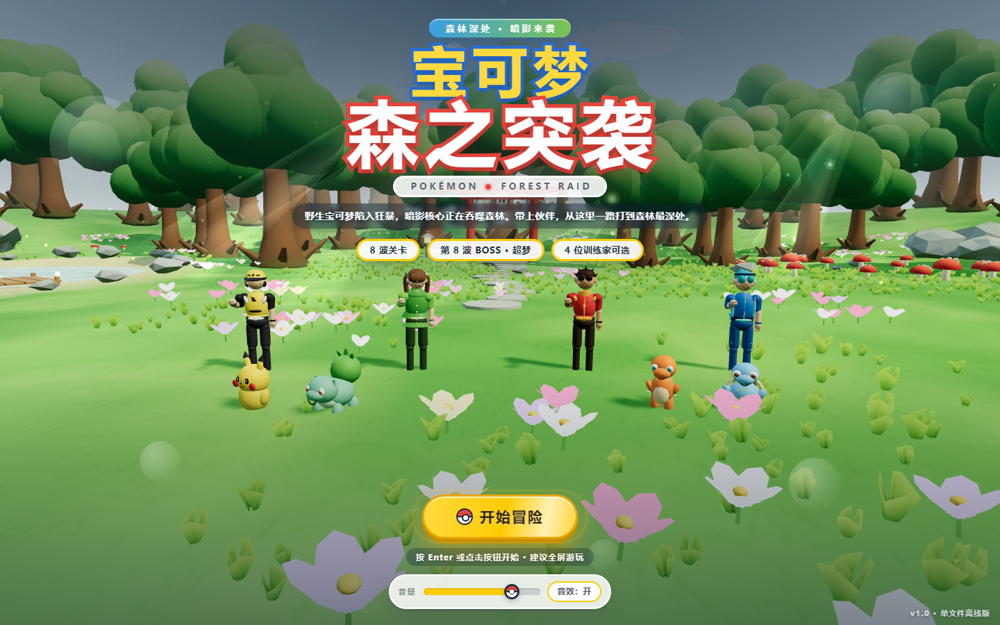
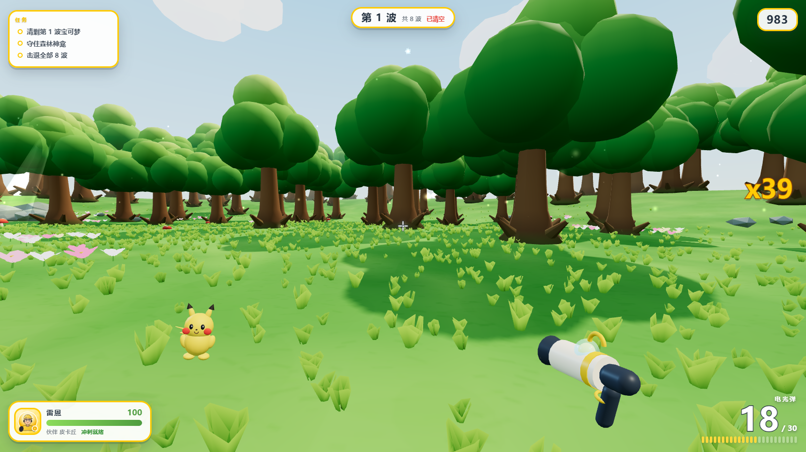
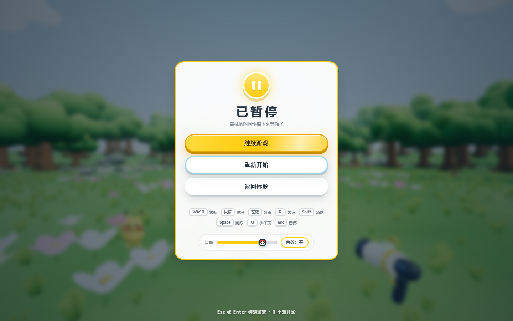
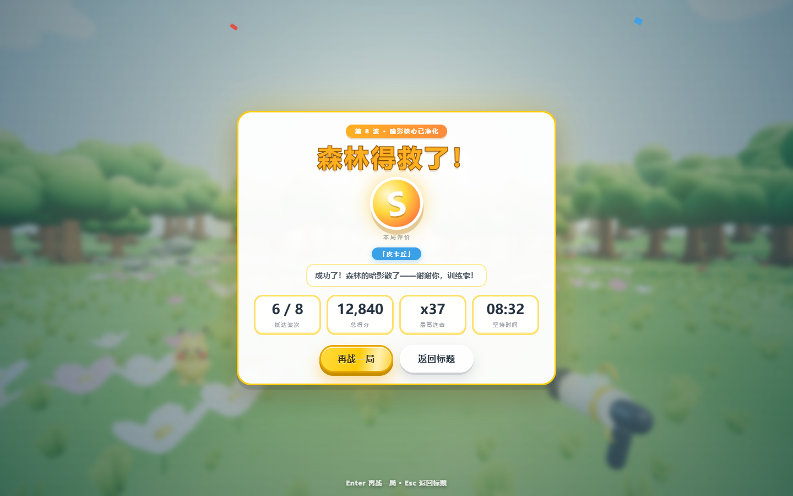
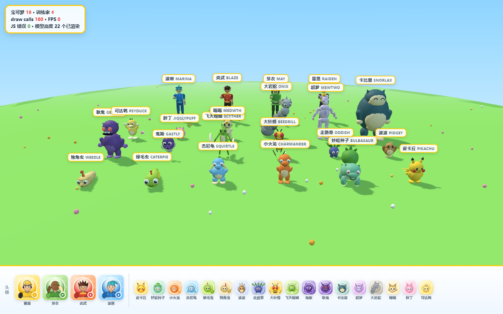

# 宝可梦 · 森之突袭（POKÉMON: FOREST RAID）

一款**单文件、可离线双击游玩**的宝可梦风格 3D 第一人称射击游戏（WebGL / Three.js r160）。
参考《几猫国产3A大作》的单文件结构：标题卡 → 选角 → 第一人称战斗 → 结算，但把世界换成**明亮卡通的宝可梦森林**。

> 代码、美术、音频全部程序化生成：没有任何外部贴图 / 模型 / 音频文件，除了内联的 three.js。



## 直接游玩

双击打开 **[dist/宝可梦森之突袭_V1.html](dist/宝可梦森之突袭_V1.html)** 即可（约 1.1 MB，浏览器需支持 WebGL2）。

## 玩法

| 操作 | 键位 |
|---|---|
| 移动 | `W A S D` |
| 瞄准 | 鼠标（点击画面锁定指针；无法锁定指针的环境下可按住左键拖动） |
| 射击 | 鼠标左键（按住连发） |
| 装填 | `R` |
| 冲刺（短暂无敌） | `Shift` |
| 跳跃 | `Space` |
| 伙伴技 | `Q` |
| 暂停 | `Esc` / `P` |
| 选角 | `←` `→` / `1-4`，`Enter` 出发 |
| 音效开关 / 音量 | 标题界面、暂停界面 |

触屏设备会自动显示虚拟摇杆与 开火 / 装填 / 冲刺 / 跳跃 / 伙伴技 按钮。

## 关卡与角色

**8 波推进 + BOSS**
1. 林中骚动（绿毛虫、独角虫）→ 2. 虫群袭来（+波波）→ 3. 草径伏击（走路草、大针蜂）→ 4. 蜂群之刺（+喵喵）→ 5. 夜幕低垂（鬼斯、胖丁、飞天螳螂）→ 6. 螳螂突袭 → 7. 精英镇守（卡比兽、大岩蛇、耿鬼）→ 8. **暗影核心：超梦（两阶段：弹幕 / 瞬移 / 召唤）**

每个波次间会恢复体力与能量；被击败会进入失败结算，通关按分数给 **S / A / B / C / D** 评价。

**4 位可选训练家**

| 角色 | 属性 / 伙伴 | 武器 | 被动 / 伙伴技 |
|---|---|---|---|
| 雷恩 RAIDEN | 电 · 皮卡丘 | 电光弹（高速直射） | 命中积电，满 5 层下一发必暴击 · 十万伏特（连锁闪电） |
| 芽衣 MAY | 草 · 妙蛙种子 | 种子散弹（5 连发） | 脱战 4 秒后回血 · 飞叶风暴（回血 + 减速） |
| 炎武 BLAZE | 火 · 小火龙 | 火花榴弹（范围爆炸） | 击杀后 2 秒增伤 40% · 火焰漩涡（范围爆炎） |
| 波琳 MARINA | 水 · 杰尼龟 | 水压穿刺枪（穿透） | 每第 5 发双倍并回血 · 海潮护盾（3 秒无敌） |

## 技术要点

- **单文件构建**：`node build.mjs` 把 three.js、9 个 JS 模块、2 个 CSS 合并成 `dist/*.html`；`node build.mjs --dev` 生成用 `<script src>` 分文件加载的 `dev.html`，改完刷新即可调试。
- **全程序化美术**：宝可梦 / 训练家由几何体拼装成模型并顶点色合批（单模型平均 7 draw call），森林由 InstancedMesh 承载 5200 草 / 589 花 / 46 蘑菇等；2D 头像与图标用 Canvas2D 绘制。
- **程序化音频**：WebAudio 合成 24 种音效 + 6 套循环音乐（标题 / 森林 / 战斗 / BOSS / 胜利 / 失败），支持静音、音量、菜单压低。
- **性能**：1280×800 集成场景 draw call ≈ 87（主场景 66 + 武器层 21），场景三角形约 67.5 万，真实 GPU 下约 95fps。

## 工程结构

```
.
├── build.mjs              构建脚本（单文件 / dev 两种产物）
├── package.json           npm scripts（build / dev / test / shot）
├── src/
│   ├── index.html         页面壳（占位符注入 CSS/JS）
│   ├── 10-audio.js        PG.audio  程序化音效与音乐
│   ├── 20-world.js        PG.world  宝可梦森林场景（地形/树/水塘/光柱/粒子）
│   ├── 30-models.js       PG.models 18 只宝可梦 + 4 位训练家模型、2D 头像/图标
│   ├── 40-util.js         PG.util   通用工具
│   ├── 50-game.js         PG.game   玩家/武器/敌人 AI/波次/BOSS/粒子
│   ├── 80-hud.js          战斗 HUD 与触屏控制
│   ├── 85-ui.js           标题/选角/暂停/结算界面
│   ├── 90-main.js         启动、渲染器、光照、输入、主循环
│   ├── 70-ui.css          全屏界面样式
│   └── 75-hud.css         HUD 样式
├── tests/
│   ├── playtest.mjs       无头 Edge 自动对局验收（25 项检查）
│   ├── shot.mjs           无头截图工具
│   └── *.html             各模块自测页（forest / creatures / audio / ui）
├── vendor/three.min.js    three.js r160（构建时内联）
├── docs/
│   ├── CONTRACT.md        模块契约（API / 分工 / 美术规范）
│   └── screenshots/       验收截图
└── dist/                  构建产物（可直接双击游玩）
```

## 构建与验收

```bash
npm run build        # -> dist/宝可梦森之突袭_V1.html
npm run dev          # -> dev.html（分文件加载，调试用）
npm test             # 无头 Edge 自动对局验收（需要安装 Edge）
```

自动化验收（`tests/playtest.mjs`，CDP 驱动，零依赖）覆盖：启动 → 标题 → 键盘进入选角 → 出发 →
战斗命中/击杀/得分 → 受击掉血 → Esc 暂停/继续 → 失败结算 → 重开归零 → 真实打通 8 波 → 胜利结算，
同时统计 draw call / 三角形 / 帧时间并收集所有 JS 错误口径。

## 截图

| | |
|---|---|
|  |  |
| 四选一选角 | 森林战斗与 HUD |
|  |  |
| 暂停 | 胜利结算 |



## 已知说明

- 在无头软件渲染器（SwiftShader）下，`InstancedMesh` + 顶点色的草会出现洋红/青色三角伪影，这是渲染器缺陷；真实 GPU 下颜色正常（已 A/B 验证）。
- 无头截图若在 CSS 入场动画结束前抓取，可能少显示部分界面元素；真实浏览器无此问题。

## License

MIT（见 [LICENSE](LICENSE)）。
